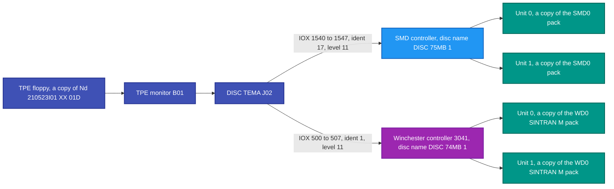
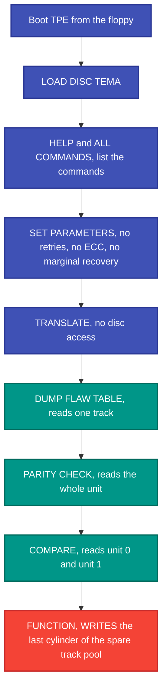
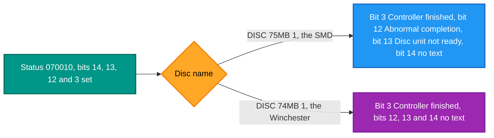
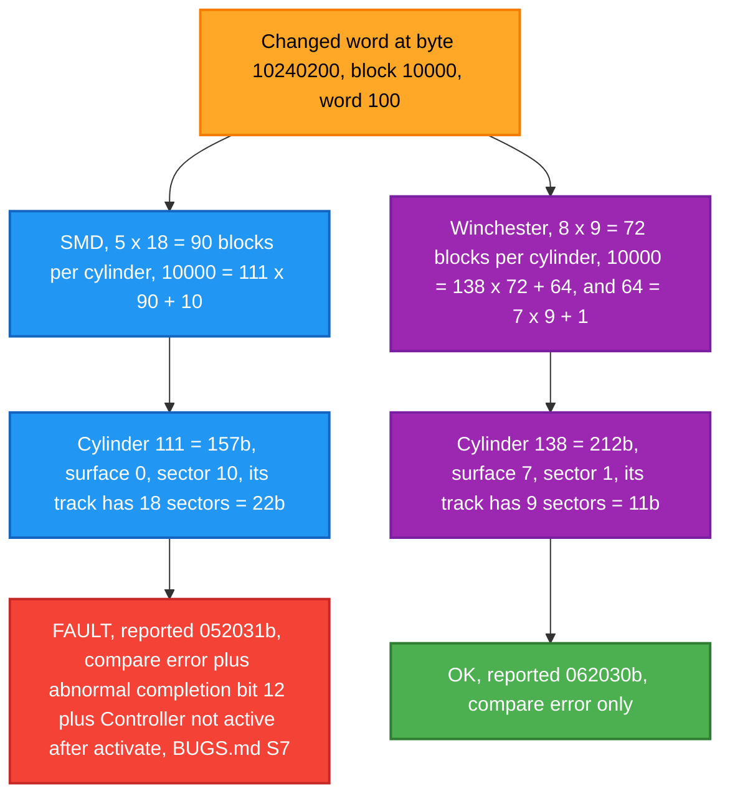
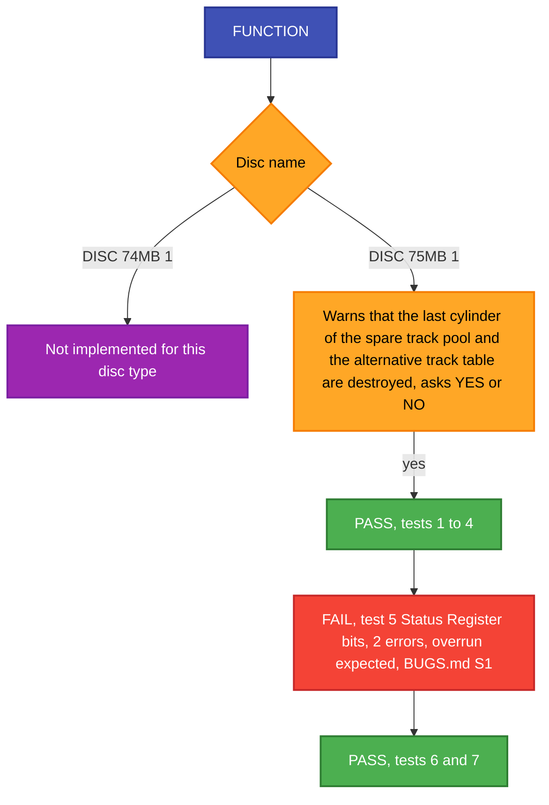

# Testing the SMD and Winchester controllers with DISC-TEMA

How the two nd100x disk controllers, the SMD and the Winchester, are tested
with DISC-TEMA, the disk test program Norsk Data shipped on the TPE floppy:
what it is, the results and known failures, a walkthrough with every screen,
and a reference for the program.

## Contents

- **Start here**
  - [1. What DISC-TEMA is, and why we run it](#1-what-disc-tema-is-and-why-we-run-it)
  - [2. Results and known failures](#2-results-and-known-failures)
  - [3. The rule: only ever run it on a copy](#3-the-rule-only-ever-run-it-on-a-copy)
- **Walkthrough**
  - [4. Walkthrough: the same session on the SMD and on the Winchester](#4-walkthrough-the-same-session-on-the-smd-and-on-the-winchester)
    - [4.1 What you need](#41-what-you-need)
    - [4.2 Boot TPE and load DISC-TEMA](#42-boot-tpe-and-load-disc-tema)
    - [4.3 List the commands](#43-list-the-commands)
    - [4.4 SET-PARAMETERS: turn off everything that hides errors](#44-set-parameters-turn-off-everything-that-hides-errors)
    - [4.5 TRANSLATE: how DISC-TEMA reads a status word](#45-translate-how-disc-tema-reads-a-status-word)
    - [4.6 DUMP-FLAW-TABLE](#46-dump-flaw-table)
    - [4.7 PARITY-CHECK: read the whole unit](#47-parity-check-read-the-whole-unit)
    - [4.8 COMPARE two identical units](#48-compare-two-identical-units)
    - [4.9 COMPARE with one word changed: how the two controllers report it](#49-compare-with-one-word-changed-how-the-two-controllers-report-it)
    - [4.10 FUNCTION](#410-function)
    - [4.11 How these screens were made](#411-how-these-screens-were-made)
- **Reference: using DISC-TEMA**
  - [5. Why the generic TPE recipe does not work here](#5-why-the-generic-tpe-recipe-does-not-work-here)
  - [6. Starting it, and the disc type](#6-starting-it-and-the-disc-type)
  - [7. What DISC-TEMA never asks for](#7-what-disc-tema-never-asks-for)
  - [8. The 23 commands, by whether they write](#8-the-23-commands-by-whether-they-write)
  - [9. SET-PARAMETERS, and the settings a real test needs](#9-set-parameters-and-the-settings-a-real-test-needs)
  - [10. FUNCTION - the closest thing to an automated test](#10-function---the-closest-thing-to-an-automated-test)
  - [11. RANDOM - a media and servo stress test](#11-random---a-media-and-servo-stress-test)
  - [12. Error messages](#12-error-messages)
  - [13. Preconditions](#13-preconditions)
- **Test status**
  - [14. Testing the nd100x SMD: what has been run, and what is left](#14-testing-the-nd100x-smd-what-has-been-run-and-what-is-left)
  - [15. Testing the nd100x Winchester](#15-testing-the-nd100x-winchester)
  - [16. What the harness needs before this can be automated](#16-what-the-harness-needs-before-this-can-be-automated)
- **Sources**
  - [17. Sources](#17-sources)

---

## 1. What DISC-TEMA is, and why we run it

### What it is

DISC-TEMA is the Norsk Data service program for testing disks and disk
controllers: the program a service engineer ran on a real machine to check a
disk card and its drives. It is File 7 on the TPE floppy
(`images/Nd-210523I01-XX-01D.img`, `DISC-TEMA-J02:TEST`) and runs under the
TPE monitor, like the other test programs in `docs/TPE-AUTORUN.md`. The
Winchester manual, ND-11.015.01 sec 5.6, names it as the checkout for that
card.

### Why we run it

nd100x emulates two disk controllers, the SMD card and the Winchester (3041)
card. SINTRAN uses only the parts of a card it needs to boot and run. DISC-TEMA
was written by Norsk Data to drive the cards themselves: the status bits, test
mode, the memory and block address registers, the hardware compare, whole-disc
reads. So it reaches paths SINTRAN never takes, and when something is wrong it
names the register or the status bit.

A clean DISC-TEMA run is not proof that a controller is right: it shows only
that nd100x passes the tests ND chose to write. The manuals stay the authority
for what the card does. A DISC-TEMA error, on the other hand, always points at
something to look at.

---

## 2. Results and known failures

### What it shows

Section 4 runs the same session on both controllers and shows every screen.
In short:

| Step | SMD (`DISC-75MB-1`) | Winchester (`DISC-74MB-1`) |
|---|---|---|
| PARITY-CHECK, whole unit | no errors | no errors |
| COMPARE, two identical units | no errors | no errors |
| COMPARE, one word changed | found at the right track, with extra bits (failure 2 below) | found at the right track |
| FUNCTION | 6 of 7 tests pass (failure 1 below) | not offered for this disc type |
| DUMP-FLAW-TABLE | No alternative track table found | No alternative track table found |
| TRANSLATE 070010 | finished, abnormal completion, unit not ready | finished |

Earlier runs, in section 15, also passed FORMAT on the Winchester (with and
without the pattern tests) and COMPARE between two Winchester units.

### Known failures, and why

| # | Where | What DISC-TEMA reports | Why | State |
|---|---|---|---|---|
| 1 | SMD, FUNCTION test 5 "Status Register bits test" | two errors, "Error after Read/Write (overrun expected), Status Bit 13b remains 0", status 041030b | DISC-TEMA puts the card in test mode and expects its data buffer (FIFO) to overrun. nd100x moves data a whole block at a time, never at the drive's speed, so an overrun cannot happen. BUGS.md S1; `docs/DISC-FIFO-OVERRUN.md` measures it. | Left red on purpose: making it pass needs word-by-word timing for one diagnostic test. |
| 2 | SMD, COMPARE when the data differs | status 052031b with bit 12 "Abnormal completion", and "Controller not active after activate" | nd100x stops the transfer at the first differing word and sets bit 12. The manual does not list a compare error as an abnormal end. BUGS.md S7. Whether the "not active" line has the same cause has not been established. | Open defect. Shows only when the data really differs; identical units compare clean. |

### Not failures, but not explained yet

- **DUMP-FLAW-TABLE** answers "No alternative track table found" on both
  controllers. Nobody has checked whether these packs ever had a table where
  DISC-TEMA looks, so this may be right.
- **TRANSLATE** decodes status bits 12 and 13 for the SMD but names neither for
  the Winchester (section 4.5). That is how DISC-TEMA reads the word, not a
  defect in nd100x.
- **The SMD image size**: the pack file is 2,730 sectors longer than the
  75 MB layout (section 6). Commands near the end of the disc are not to be
  trusted until that is explained.

Winchester FUNCTION answering "Not implemented for this disc type" is not a
failure: DISC-TEMA has no FUNCTION test for `DISC-74MB-1`.

---

## 3. The rule: only ever run it on a copy

**DISC-TEMA writes to the pack. Run it only against a throwaway copy.**

Never point it at `SMD0.IMG` or anything under
`images/`. Copy the image to a scratch directory and
pass the copy to `--smd0=`:

```sh
cp SMD0.IMG "$SCRATCH/dt.img"
build/bin/nd100x --boot=floppy --image=FLOPPY.IMG --smd0="$SCRATCH/dt.img" --pipe
```

This is not the ordinary "booting writes to the pack" drift. `FORMAT` destroys
the pack outright, `FUNCTION` destroys a cylinder every time it runs, and
`COPY` overwrites the destination disk completely. The command table in
section 8 marks every command READS or WRITES; check it before typing
anything.

---

## 4. Walkthrough: the same session on the SMD and on the Winchester

This section shows one DISC-TEMA session from boot to the last command, run
once against the SMD and once against the Winchester, so the two controllers
can be compared screen by screen. Every block below is the exact screen,
character for character, from a run of nd100x at commit `aad10c1`. Nothing
has been typed in by hand or shortened. Where the two screens are the same,
it is shown once.

### 4.1 What you need

Everything comes from this repository:

- the TPE floppy `images/Nd-210523I01-XX-01D.img` (TPE monitor B01 and
  `DISC-TEMA-J02:TEST`);
- the SMD pack `images/SMD0.IMG.bz2` (a SINTRAN pack, 75 MB);
- the Winchester pack `images/WD0-SINTRAN-M.IMG.bz2` (SINTRAN M on a
  Micropolis 1325, `DISC-74MB-1`).

What is connected to what. One run uses one of the two controllers, with
two units on it.

The colours mean the same in every diagram here: blue is the SMD, purple the
Winchester, indigo the programs, teal disc data, amber a decision or a
warning, green a pass and red a write or a failure. Every box also says in
words what it is. Inside the diagrams names are written without hyphens
(`DISC 75MB 1` for `DISC-75MB-1`), as the NDInsight Mermaid rules ask, so
they draw in older Mermaid versions too.



Unpack each pack into a scratch directory and use **copies** (section 3).
COMPARE needs a second unit, so make two copies of each pack:

```sh
cp images/Nd-210523I01-XX-01D.img "$SCRATCH/tpe.img"
bzcat images/SMD0.IMG.bz2         > "$SCRATCH/smd0.img"
cp "$SCRATCH/smd0.img" "$SCRATCH/smd1.img"
bzcat images/WD0-SINTRAN-M.IMG.bz2 > "$SCRATCH/wd0.img"
cp "$SCRATCH/wd0.img" "$SCRATCH/wd1.img"
```

Then start nd100x from the floppy with the packs on the controller you want
to test:

```sh
# SMD
build/bin/nd100x --boot=floppy --image="$SCRATCH/tpe.img" \
    --smd0="$SCRATCH/smd0.img" --smd1="$SCRATCH/smd1.img"

# Winchester
build/bin/nd100x --boot=floppy --image="$SCRATCH/tpe.img" \
    --wd0="$SCRATCH/wd0.img" --wd1="$SCRATCH/wd1.img"
```

The runs shown here added `--pipe` and were typed by a script that waits for
each prompt before it answers (section 4.11).

### 4.2 Boot TPE and load DISC-TEMA

In the screens from here on, **bold** is what was typed. Each typed line ends
with RETURN.

The session goes from steps that do not touch the disc, through steps that
only read, to the one step that writes:



Same on both controllers. Press RETURN once to get the first prompt.

<pre>
    TPE Monitor, ND-100 series - Version: B01 - 1988-10-07
&nbsp;
&nbsp;
The command HELP gives you the full list of available commands
&nbsp;
TPE&gt;<b>LOAD DISC-TEMA</b>
&nbsp;
&nbsp;
    DISC-TEMA - VERSION: J02 - 1990-04-02
&nbsp;
&nbsp;
TPE&gt;
</pre>

J02 does **not** ask for a disc type when it loads. Every command that
touches a disc asks `Disc name:` itself (section 6).

### 4.3 List the commands

Same on both controllers. `HELP` answers with a `Command:` prompt; type
`ALL-COMMANDS` there. A blank line at `Command:` printed `All-commands` and
then nothing more for 150 seconds, so give the word.

<pre>
TPE&gt;<b>HELP</b>
Command: <b>ALL-COMMANDS</b>
&nbsp;
Monitor commands
****************
&gt; MODE &lt;input file name&gt; &lt;output&gt;
&gt; DATCL
&gt; DELETE-MACROS
&gt; DUMP-PRINTER-BUFFER (&lt;from&gt; &lt;to&gt;)
&gt; EXIT
&gt; EXPLAIN-COMMAND &lt;command&gt;
&gt; HELP &lt;command&gt;
&gt; LIST-FILES &lt;file name&gt;
&gt; LIST-MACROS &lt;macro name&gt;
&gt; LOAD-PROGRAM &lt;file name&gt;
&gt; DEFINE-MACRO &lt;name&gt; &lt;body&gt;
&gt; MONITOR-HELP &lt;command&gt;
&gt; OPCOM
&gt; PRINT-NOTE &lt;note number&gt;
&gt; PROGRAM-HELP &lt;command&gt;
&gt; PROGRAM-STATUS
&gt; SET-CONSOLE-DEVICE-NUMBER &lt;logical or hardware number&gt;
&gt; SET-PRINTER-DEVICE-NUMBER &lt;logical or hardware number&gt;
&gt; SET-PRINTER-MODE &lt;mode&gt; (&lt;buffer size&gt;)
&gt; SET-TERMINAL-TYPE &lt;type&gt;
&gt; TERMINAL-MODE &lt;full page stop&gt;
&gt; UPDAT &lt;minute&gt; &lt;hour&gt; &lt;day&gt; &lt;month&gt; &lt;year&gt;
&nbsp;
Program commands
****************
&gt; ALIGN
&gt; ALLOCATE-BUFFERS
&gt; CHANGE
&gt; CLEAR-COUNTERS
&gt; CLEAR-DEVICE
&gt; COMPARE
&gt; COPY
&gt; DUMP-DISC-CONTENT
&gt; DUMP-FLAW-TABLE
&gt; FORMAT
&gt; FUNCTION
&gt; MATCH
&gt; PARITY-CHECK
&gt; PRIORITY-SELECT
&gt; RANDOM-TEST
&gt; REFRESH
&gt; SEEK
&gt; SET-DISC-CONTENT
&gt; SET-PARAMETERS
&gt; TRANSLATE
&gt; VERIFY
&nbsp;
TPE&gt;
</pre>

J02 lists 21 program commands. The manual's 23 (section 8) also have
`SET-DISC-TYPE` and `SCOPE-LOOP`, which J02 does not list, and the manual's
`RANDOM` is `RANDOM-TEST` here.

### 4.4 SET-PARAMETERS: turn off everything that hides errors

Same on both controllers. These answers switch off retries, marginal recovery
and ECC correction, so an error in the emulated controller shows instead of
being repaired (section 9), and run FUNCTION once.

<pre>
TPE&gt;<b>SET-PARAMETERS</b>
Directory mode on                     (YES or NO): <b>yes</b>
No. of retries on READ              (0 to 64 dec): <b>0</b>
No. of retries on WRITE             (0 to 64 dec): <b>0</b>
Marginal recovery allowed             (YES or NO): <b>no</b>
ECC correction allowed                (YES or NO): <b>no</b>
No. of pattern tests in FORMAT       (0 to 3 dec): <b>3</b>
Max ECC error length to tolerate    (1 to 11 dec): <b>1</b>
Release units after operations        (YES or NO): <b>no</b>
Include all tests in FUNCTION         (YES or NO): <b>yes</b>
No. of times to run tests        (1 to 65535 dec): <b>1</b>
&nbsp;
TPE&gt;
</pre>

J02 asks ten questions, in this order and with this wording. The manual's
table in section 9 has twelve, in another order.

### 4.5 TRANSLATE: how DISC-TEMA reads a status word

No disc access. The disc name decides how the status word is read, so the
same two numbers give different answers. 070010 and 060011 are the two
values a real 3041 Winchester card returned (BUGS.md W10).



SMD (`DISC-75MB-1`):

<pre>
TPE&gt;<b>TRANSLATE</b>
Disc name: <b>DISC-75MB-1</b>
Address type: <b>STATUS</b>
Status (0 to 177777 oct): <b>070010</b>
&nbsp;
   Status 070010b
   - Controller finished
   - Abnormal completion
   - Disc unit not ready
&nbsp;
Address type: <b>STATUS</b>
Status (0 to 177777 oct): <b>060011</b>
&nbsp;
   Status 060011b
   - Controller finished
   - Disc unit not ready
&nbsp;
Address type: <b>EXIT</b>
&nbsp;
TPE&gt;
</pre>

Winchester (`DISC-74MB-1`):

<pre>
TPE&gt;<b>TRANSLATE</b>
Disc name: <b>DISC-74MB-1</b>
Address type: <b>STATUS</b>
Status (0 to 177777 oct): <b>070010</b>
&nbsp;
   Status 070010b
   - Controller finished
&nbsp;
Address type: <b>STATUS</b>
Status (0 to 177777 oct): <b>060011</b>
&nbsp;
   Status 060011b
   - Controller finished
&nbsp;
Address type: <b>EXIT</b>
&nbsp;
TPE&gt;
</pre>

For the SMD, DISC-TEMA reads bit 12 as "Abnormal completion" and bit 13 as
"Disc unit not ready". For the Winchester it names only bit 3: bits 12, 13
and 14 get no text at all. `HELP` at `Address type:` lists the other types:
Physical, Logical, Page, Status and Exit.

### 4.6 DUMP-FLAW-TABLE

Reads one track. Both controllers give the same answer; the unit prompt is
the only difference (the SMD card takes four units, the Winchester card two).

SMD:

<pre>
TPE&gt;<b>DUMP-FLAW-TABLE</b>
Disc name: <b>DISC-75MB-1</b>
Unit (0 to 3 oct): <b>0</b>
&nbsp;
No alternative track table found.
&nbsp;
TPE&gt;
</pre>

Winchester:

<pre>
TPE&gt;<b>DUMP-FLAW-TABLE</b>
Disc name: <b>DISC-74MB-1</b>
Unit (0 to 1 oct): <b>0</b>
&nbsp;
No alternative track table found.
&nbsp;
TPE&gt;
</pre>

Whether these packs ever had a table where DISC-TEMA looks has not been
checked (section 14).

### 4.7 PARITY-CHECK: read the whole unit

Reads every track without moving the data to memory. Both controllers read
the whole unit with no errors:

SMD:

<pre>
TPE&gt;<b>PARITY-CHECK</b>
Disc name: <b>DISC-75MB-1</b>
Unit (0 to 3 oct): <b>0</b>
&nbsp;
================
&nbsp;
TPE&gt;
</pre>

Winchester:

<pre>
TPE&gt;<b>PARITY-CHECK</b>
Disc name: <b>DISC-74MB-1</b>
Unit (0 to 1 oct): <b>0</b>
&nbsp;
================
&nbsp;
TPE&gt;
</pre>

The bar is a progress line. DISC-TEMA first prints 16 dashes as a scale,
goes back to the start of the line, and writes one `=` over a dash for each
sixteenth of the disc it has done, with a `>` marking how far it has got. A
full line of `=` means the whole unit was read. A bell sounds at the end. An
error is printed under the bar where it happens, and the bar goes on
(section 4.9).

### 4.8 COMPARE two identical units

Unit 0 against unit 1, two copies of the same pack. COMPARE uses the
compare built into the card (section 8). No errors on either controller:

SMD:

<pre>
TPE&gt;<b>COMPARE</b>
From disc name: <b>DISC-75MB-1</b>
Unit (0 to 3 oct): <b>0</b>
To   disc name: <b>DISC-75MB-1</b>
Unit (0 to 3 oct): <b>1</b>
&nbsp;
================
&nbsp;
TPE&gt;
</pre>

Winchester:

<pre>
TPE&gt;<b>COMPARE</b>
From disc name: <b>DISC-74MB-1</b>
Unit (0 to 1 oct): <b>0</b>
To   disc name: <b>DISC-74MB-1</b>
Unit (0 to 1 oct): <b>1</b>
&nbsp;
================
&nbsp;
TPE&gt;
</pre>

### 4.9 COMPARE with one word changed: how the two controllers report it

The same run, but one word on the unit 1 copy is changed first: byte offset
10240200 in the image, which is block (LBA) 10000, word 100. The word was
000000 and is set to 177777:

```sh
printf '\377\377' | dd of="$SCRATCH/smd1.img" bs=1 seek=10240200 conv=notrunc
printf '\377\377' | dd of="$SCRATCH/wd1.img"  bs=1 seek=10240200 conv=notrunc
```

SMD:

<pre>
TPE&gt;<b>COMPARE</b>
From disc name: <b>DISC-75MB-1</b>
Unit (0 to 3 oct): <b>0</b>
To   disc name: <b>DISC-75MB-1</b>
Unit (0 to 3 oct): <b>1</b>
&nbsp;
==&gt;-------------
***ERROR*** 1996.10.31 16:19:09  DISC-75MB-1 Unit 1
            Requested transfer address:
            Cylinder:  157b Surface:  0b Sector:   0b
            Hardware Status: 052031b
            Controller finished
            Compare error
            Abnormal completion
            Additional Status: 100000b
            Controller not active after activate
            Operation was: Compare
            Block size was: 22b
&nbsp;
================
&nbsp;
TPE&gt;
</pre>

Winchester:

<pre>
TPE&gt;<b>COMPARE</b>
From disc name: <b>DISC-74MB-1</b>
Unit (0 to 1 oct): <b>0</b>
To   disc name: <b>DISC-74MB-1</b>
Unit (0 to 1 oct): <b>1</b>
&nbsp;
==&gt;-------------
***ERROR*** 1996.10.31 16:19:11  DISC-74MB-1 Unit 1
            Requested transfer address:
            Cylinder:  212b Surface:  7b Sector:   0b
            Hardware Status: 062030b
            Controller finished
            Compare error
            Operation was: Compare
            Block size was: 11b
&nbsp;
================
&nbsp;
TPE&gt;
</pre>

Both find the one word, at the right place. DISC-TEMA compares a whole track
at a time, so it reports the start of the track that holds the word. The same
block lands on a different cylinder on each controller, because the two
drives have different layouts:



| | SMD | Winchester |
|---|---|---|
| Layout | 5 surfaces x 18 sectors = 90 blocks per cylinder | 8 surfaces x 9 sectors = 72 blocks per cylinder |
| Block 10000 is | cylinder 111 (157b), surface 0, sector 10 | cylinder 138 (212b), surface 7, sector 1 |
| Reported | cylinder 157b, surface 0b, block size 22b (18) | cylinder 212b, surface 7b, block size 11b (9) |
| Hardware status | 052031b: bits 0, 3, 4, 10, 12, 14 | 062030b: bits 3, 4, 10, 13, 14 |

Where they differ:

- **The SMD sets bit 12, "Abnormal completion", on a compare error, and
  DISC-TEMA adds "Controller not active after activate".** nd100x ends the
  transfer at the first differing word and sets bit 12. BUGS.md S7 reads the
  manual (ND-11.020.01, mode M3, sec 3.7.2) as saying a compare error is not
  an abnormal end, so it should neither end the transfer nor set bit 12. This
  run is the first one to show S7. Whether the "not active" line comes from
  the same defect has not been established.
- **The Winchester status has bit 13 set** (always 1 on a 3041) and bit 12
  clear: bit 12 is the drive's Track 000 line (BUGS.md W10), and the heads are
  on cylinder 138, not 0.
- DISC-TEMA prints the date and time on each error line. The time matched the
  host clock; where the year 1996 comes from has not been looked into.

### 4.10 FUNCTION



SMD. **FUNCTION writes:** it destroys the last cylinder of the spare track
pool, and it says so before it starts.

<pre>
TPE&gt;<b>FUNCTION</b>
Disc name: <b>DISC-75MB-1</b>
Unit (0 to 3 oct): <b>0</b>
On this Disc type, Function will destroy data in the last
cylinder in the spare track buffer pool !
(Including the Alternative Track Table.)
&nbsp;
Do you still want to continue (YES or NO): <b>yes</b>
&nbsp;
  1. Data way to controller test  === End of test ===
  2. Memory Address Register test === End of test ===
  3. Block Address Register test  === End of test ===
  4. Test-Mode test               === End of test ===
  5. Status Register bits test
Error after Read (overrun expected), Status Bit 13b remains 0 !        7)
   Status 041030b, Unit 0
   - Controller finished
   - Data error
&nbsp;
&nbsp;
Error after Write (overrun expected), Status Bit 13b remains 0 !        7)
   Status 041030b, Unit 0
   - Controller finished
   - Data error
&nbsp;
=== End of test ===
  6. Operation test               === End of test ===
  7. Read-Seek-Condition test     === End of test ===
&nbsp;
TPE&gt;
</pre>

Six of the seven tests pass. Test 5 expects an overrun (status bit 11, "FIFO
over/underrun") that nd100x can never produce; that is BUGS.md S1, and
`docs/DISC-FIFO-OVERRUN.md` explains why it is left red. Print note `7)` is
explained in section 12.

Winchester:

<pre>
TPE&gt;<b>FUNCTION</b>
Disc name: <b>DISC-74MB-1</b>
Unit (0 to 1 oct): <b>0</b>
&nbsp;
Not implemented for this disc type !
&nbsp;
TPE&gt;
</pre>

DISC-TEMA has no FUNCTION test for `DISC-74MB-1`. ND-11.015.01 sec 5.6 lists
FORMAT, PARITY-CHECK and COMPARE as the checkout for this card (section 15).

### 4.11 How these screens were made

Each session was one run of nd100x with `--pipe`, from fresh copies of the
packs in `images/`, typed by a script that waits for the prompt (`TPE>`, or a
question ending in `:`) before it sends the next line. The script kept every
byte the emulator wrote, and the blocks above are those bytes shown the way a
plain terminal shows them: carriage return to the start of the line,
backspace one column left, the bell not shown. Two runs from separate copies
gave the same screens, apart from the time on the error lines. Each session
took 22 to 61 seconds including the boot.

The answers typed, in order:

- SMD, one unit: `LOAD DISC-TEMA`, `HELP`, `ALL-COMMANDS`, `SET-PARAMETERS`
  `yes 0 0 no no 3 1 no yes 1`, `TRANSLATE DISC-75MB-1 STATUS 070010 STATUS 060011 EXIT`,
  `DUMP-FLAW-TABLE DISC-75MB-1 0`, `PARITY-CHECK DISC-75MB-1 0`,
  `FUNCTION DISC-75MB-1 0 yes`.
- SMD, two units: `LOAD DISC-TEMA`, the same SET-PARAMETERS,
  `COMPARE DISC-75MB-1 0 DISC-75MB-1 1`.
- Winchester, two units: as the SMD with `DISC-74MB-1`, then
  `COMPARE DISC-74MB-1 0 DISC-74MB-1 1` and `FUNCTION DISC-74MB-1 0`.

That script is not in this repository yet; section 16 lists what a driver in
`tools/` needs.

---

## 5. Why the generic TPE recipe does not work here

`docs/TPE-AUTORUN.md` section 4 documents the pattern
used by `INSTRUCTION-C03`, `MEMORY-D04` and `PAGING-C02`:

```
<program-name>            % load
[ set-para,<args...> ]    % optional
run                       % execute
```

**The load works; the `run` does not.**

**There is no `run` command.** DISC-TEMA has 23 commands of its own and `run`
is not among them, which is why driving it the generic way answers
`*** No such command ***`. Loading was never the problem.

### How to load a TPE program - always use LOAD

```
TPE>LOAD DISC-TEMA <CR>
```

The bare program name also works, but **only while nothing has been loaded
yet**. Once any program is in the monitor, loading another one needs `LOAD`.

Use `LOAD` every time. It is correct in both states, and neither a written
procedure nor a script can be sure the monitor is still fresh - a previous
step, an operator, or a retry may already have loaded something. The bare name
is the special case, not the rule.

It is also not a single test that starts and finishes. It is an interactive
service program: load it, and it sits at its prompt waiting for one of 23
commands, most of which then ask a series of questions.

### Two console conventions that apply here and everywhere in TPE

- **`Command:` is the help filter prompt.** Typing `help` and pressing return
  does not print a list; it asks what to filter the listing by. The manual
  says a blank line or a filter string gets the listing. In J02 under nd100x,
  a blank line printed `All-commands` and then nothing; typing `ALL-COMMANDS`
  gives the full list (section 4.3).
- **A comma supplies one blank parameter inline**, so a command never has to
  prompt. `HELP,,,` is HELP with three blank parameters. The number of commas
  must match the number of parameters the command takes.

---

## 6. Starting it, and the disc type

```
TPE>LOAD DISC-TEMA <CR>
```

The manual says it then asks for a **DISC TYPE** before accepting any
command, and that a bare `<CR>` takes the default, entry 23, `DISC-75MB-1`.
There are 94 types. **J02 does not do that:** it loads straight to `TPE>`, and
each command that touches a disc asks `Disc name:` (or `From disc name:` and
`To   disc name:`) itself (section 4). The names used for nd100x are
`DISC-75MB-1` for the SMD and `DISC-74MB-1` for the Winchester.

In the manual's description, the type answers both the "FROM" and the "TO" disc. `SET-DISC-TYPE` changes
them individually afterwards, and version D additionally accepts the type
`VARYING`, which makes every command ask for its own type.

**For nd100x, the default is the correct answer.** nd100x's SMD presents the
75 MB geometry, and it matches the manual exactly:

| | `src/devices/smd/disk_smd.h:53-58` | manual prompt ranges |
|---|---|---|
| Surfaces | max 5 | `SURFACE NUMBER (DATA HEAD) (0-4 OCT.):` |
| Sectors  | max 18 | `SECTOR NUMBER (0-21 OCT.):` (0-17 dec) |
| Cylinders| 823 (0-822) | `CYLINDER NUMBER (0-1466 OCT.):` (0-822 dec) |
| Total sectors | 220526 octal | `AMOUNT (NO. OF SECTORS) (1-220526 OCT.):` |

`device_smd.c:996` confirms `DISK_75_MB` is the default type, and the device
is at IOX 1540-1547, ident 17, level 11.

**Open item, not yet resolved:** `SMD0.IMG` is 78,643,200 bytes, which is
76,800 sectors of 1024 bytes. The 75 MB geometry is 823 x 5 x 18 = 74,070
sectors. The image is therefore larger than the geometry describes, by 2,730
sectors. Whether that is padding, a different pack layout, or a mismatch has
not been established, and it should be before any address-range command is
trusted near the end of the disc.

---

## 7. What DISC-TEMA never asks for

There is **no controller-address or device-number prompt anywhere in the
chapter.** The disc *type* implies the controller. So the earlier assumption
that it would ask for an IOX address was wrong.

"Subunit" appears only in the phrase "unit- (subunit-) number" and in a note
about "artificially divided subunits (2-75MB or 3-75MB)". There is no separate
subunit prompt: the subunit is encoded in the type name, e.g. `DISC-2-75MB-1`
against `DISC-2-75MB-2`.

Unit prompts vary in spelling between commands, which matters for any harness
matching on prompt text:

```
Unit (0-1 Oct.):          CLEAR-DEVICE, MATCH, COPY, PARITY-CHECK
Unit (0-3 Oct):           ALIGN
Unit [0-3 Oct.]:          FORMAT           (square brackets)
Unit (0 to 3 oct):        DUMP-FLAW-TABLE, REFRESH
UNIT(S) {0-3 Dec.}:       FUNCTION         (decimal, 1-4 units, space or comma separated)
UNIT NUMBER (0-3 OCT.):   COMPARE, VERIFY, DUMP-DISC-CONTENT, SET-DISC-CONTENT, SEEK
```

Numbers are octal unless the prompt says `Dec.`. A bare `<CR>` takes the
default. Commands may be abbreviated and typed in lower case.

---

## 8. The 23 commands, by whether they write

### Safe - read only

| Command | What it does | Prompts |
|---|---|---|
| `PARITY-CHECK` | Reads one disk area without storing it in memory, to see whether addresses and data read without ECC error. The safest command in the program. | `Unit (0-1 Oct.):` |
| `VERIFY` | Reads two disk areas and compares them word by word in software. Terminates by itself after the given amount. | two address blocks, then `AMOUNT (NO. OF SECTORS) (1-216374 OCT.):` |
| `COMPARE` | Compares memory against disc using the hardware bit-compare on the interface. | two address blocks, `AMOUNT...`, `DISC AREAS OVERLAP EACH OTHER. OK ? (YES/NO):` when they overlap, `BLOCK SIZE (1-132 OCT.):` |
| `MATCH` | COMPARE until a compare error, then VERIFY at that spot. Cannot run under SINTRAN. | FROM unit, TO unit |
| `SEEK` | Consecutive seeks between two addresses. Head motion only, no transfer. **Runs forever until ESCAPE.** | FROM block with unit, TO block without unit |
| `CLEAR-DEVICE` | Return-to-zero seek. No transfer at all. | `Unit (0-1 Oct.):` |
| `DUMP-DISC-CONTENT` | Dumps an area to the printer device; a line identical to the one before prints as `SAME`. Needs `SET-PRINTER-DEVICE-NUMBER` set first. | address block, `AMOUNT (NO. OF SECTORS) (1-22 OCT.):` |
| `DUMP-FLAW-TABLE` | Prints the bad-track/alternative-track table from the last track of the disc. | `Unit (0 to 3 oct):` |
| `TRANSLATE` | Converts between physical, logical and page addresses, and decodes a status word to text. No disc access. | `ADDRESS TYPE:` then cylinder/surface/sector |
| `SET-DISC-TYPE` | Sets the FROM and TO disc types. | `SET NEW "FROM" DISC NAME:`, `SET NEW "TO" DISC NAME:` |
| `SET-PARAMETERS` | The mode settings, section 9. | 12 prompts in the manual, 10 in J02 (section 4.4) |
| `CLEAR-COUNTERS` | Clears the ECC, retry, marginal-recovery and transfer counters. | five `CLEAR ... (YES/NO):` questions |
| `PRIORITY-SELECT` | Dual-port option only; holds a drive until the next command finishes. Not executable under SINTRAN. | not stated |
| `ALIGN` | Head alignment. Needs a removable pack and a special ALIGN pack; errors with `No align cylinder for this disk.` otherwise. | `Unit (0-3 Oct):`, `CYLINDER`, `HEAD`, then single-key sub-commands |
| `ALLOCATE-BUFFERS` | Inspects and alters the memory buffers used for disc DMA. Prompt is `Buffalo:`. Not possible on ST506-type interfaces. | menu 1-4 |

### Destructive - scratch copy only

| Command | What it destroys |
|---|---|
| `FORMAT` | **The whole pack.** "This command will destroy the existing data on the disk." Asks `Do you still want to continue (Yes/No):` and then runs a table editor with `APPEND`, `DELETE`, `LIST-TABLE`, `REMOVE-TABLE`, `START-FORMATTING`. |
| `COPY` | **The destination disk.** "This command will 'destroy' the data on the destination disk." Cannot run under SINTRAN. |
| `FUNCTION` | **One cylinder, every run.** See section 10. |
| `SET-DISC-CONTENT` | Writes a generated pattern over the sectors given. |
| `CHANGE` | Inspects and changes single words on the disc. The manual gives no example and no prompts. |
| `REFRESH` | Reformats one track and writes the data back. Phoenix discs cannot be refreshed in the III version. Warns if the track was already reallocated, and the manual says do not continue in that case. |
| `RANDOM` | Only when `TEST-TYPE` is set to `write-compare`. See section 11. |

### Unclassified

`SCOPE-LOOP` is listed as a command name and **described nowhere** - not in
chapter 5, not in ND-10324E, not in ND-210523G. No description, no prompts, no
statement of whether it writes. Treat it as unknown, not as safe.

---

## 9. SET-PARAMETERS, and the settings a real test needs

This table is the manual's. **J02 asks ten questions, not twelve, in another
order and with other wording**; section 4.4 has the exact J02 screen with the
answers used for the nd100x runs. Defaults are in angle brackets, as the
manual prints them.

| # | Prompt | Default | For a thorough test |
|---|---|---|---|
| 1 | `Directory mode on (YES or NO):` | `<YES>` | YES gives unit-only addressing; NO requires full cylinder/surface/sector and an amount |
| 2 | `Marginal recovery allowed (YES or NO):` | `<YES>` | **NO** - "For a thorough test, marginal recovery should not be allowed." |
| 3 | `ECC correction allowed (YES or NO):` | `<YES>` | **NO** - "For a thorough test, ECC operation should not be allowed." |
| 4 | `Single surface format (YES or NO):` | `<NO>` | leave NO - "Should not be used. Only for debugging HW." |
| 5 | `Override obligatory reallocating while formatting (Yes/No):` | not stated | leave alone - "This is not recommended." |
| 6 | `No of retries on READ (0 to 64 dec):` | `<27>` | **0** - "For a thorough test, READ retries should be 0." |
| 7 | `No of retries on WRITE (0 to 64 dec):` | `<3>` | **0** - "For a thorough test, WRITE retries should be 0." |
| 8 | `Number of test patterns to use during formatting:` | `<3>` | more patterns finds more bad tracks. Range is printed as `(1-3 Dec.)` in the table and `(0 to 3 dec)` in the explanation - the manual contradicts itself |
| 9 | `No of bits to accept before reallocating (1 to 11 dec):` | `<1>` | **1**. No effect if ECC is disallowed |
| 10 | `Skip any test in function (YES or NO):` | `<NO>` | YES makes it ask about each test in FUNCTION individually |
| 11 | `Number of times for function to loop (1 to 65535 dec):` | `<4>` | the FUNCTION loop count; ESCAPE also ends it |
| 12 | `Do you want to release units after operations (YES or NO):` | `<NO>` | only relevant with a disc switch and ECC disc |

The first three matter most: **left at their defaults, DISC-TEMA hides exactly
the errors an emulator test is trying to find.** Marginal recovery retries with
the heads off track, ECC correction repairs the data in software, and 27 read
retries paper over an intermittent failure. All three must be off for a result
to mean anything about the SMD implementation.

---

## 10. FUNCTION - the closest thing to an automated test

This is the command that most resembles `run` in the other TPE programs, and
it is **destructive**, though in a bounded way.

The example below is the manual's. **J02 differs:** it asks `Disc name:` and
a single `Unit (0 to 3 oct):`, warns that the alternative track table is
destroyed too, then names its seven tests and prints `=== End of test ===`
after each one. Section 4.10 has the exact J02 screens for both controllers.

```
TPE>function <CR>

DISC-75MB-1

On this disk type FUNCTION will "destroy" data in the last cylinder in the
spare track buffer pool.
Most new disks have an area reserved for function test. The data pool and the
flaw-table are not affected by the function test.

DISC-TEMA will give a warning ONLY when data may be lost.

Do you still want to continue (Yes/No):Y <CR>

Specify from 1 to 4 unit numbers, terminated by CR. Separate the numbers with
a space or a comma (,). The units specified must be turned ON and ready. The
units NOT specified must be turned OFF, or nonexistent.
UNIT(S) {0-3 Dec.}: 0 1 2 3 <CR>
TPE>
```

Points that decide whether it can be automated:

- **What it tests:** "Function is mainly a test of the disk interface, and the
  disk drive and the disk pack is only partially tested." The individual
  subtests are never named in the manual.
- **What a pass looks like:** in the manual's example it simply returns to
  `TPE>` with no output. J02 prints each test's name and `=== End of test ===`
  (section 4.10), and a failure shows up as an error report inside the test,
  with the messages of section 12.
- **This breaks the usual harness classification.** `tools/tpe_autorun.py`
  decides PASS/FAIL/INCONCLUSIVE by scanning for markers. FUNCTION has none,
  so silence is success and any error text is failure - the inverse of how the
  other programs are read.
- **Unit requirement:** "The units specified must be turned ON and ready. The
  units NOT specified must be turned OFF, or nonexistent." For nd100x that
  means only configured `--smd0..3` units may be listed.
- **Loop count** comes from SET-PARAMETERS item 11, default 4. ESCAPE ends it.
- **Version C bug, fixed in D:** on a 38 MB disc, FUNCTION used cylinder 0 for
  all tests and destroyed it. Not relevant at 75 MB, but it shows the "bounded"
  area is version- and type-dependent and should not be assumed.

---

## 11. RANDOM - a media and servo stress test

`RANDOM` enters its own sub-prompt, `RND:`, with commands `RUN-TEST`,
`ADDRESS-MODE`, `TEST-TYPE`, `LIMIT-ADDRESSES`, `AMOUNT-SET`, `WRITE-PROTECT`,
`LIST-PARAMETERS`, `SET-PARAMETERS`, `EXIT`.

The safety statement is explicit: "The DATA on the disk media will NOT normally
be ruined by D-T random test, unless WRITE is specified. To enable write, you
must bypass write protect." The write-protect flag starts ON and makes the
program ask before any write operation.

`TEST-TYPE` decides everything:

1. `read parity` - checks parity at the calculated address, no transfer
2. `read only` - transfers to memory
3. `read-compare` - the interface compares the memory buffer against the disc
4. `write-compare` - **writes to the disc**, then compares
5. `seek-only` - seek to the calculated track, finished on ON CYLINDER

Default is read and compare, so **RANDOM at its defaults is read only**.

`ADDRESS-MODE` chooses `INCREMENT-DECREMENT` or `RANDOM`; the manual notes the
random pattern repeats identically on a new RUN unless the test area size
changes, which makes it reproducible. `EXIT` resets every RANDOM parameter.

Worth knowing: RANDOM's own initial values are the **opposite** of the global
SET-PARAMETERS defaults. "Initially ECC correction and marginal recovery are
not allowed. Initially no read or write retries are allowed." That is the
strict setting the global parameters have to be talked into.

`RUN-TEST` prints a list of the operations and the commands accepted during a
run without interrupting it. Neither that text nor the termination condition
is stated in the manual, so **how a RANDOM run ends is unknown** and must be
established by experiment before it is automated.

---

## 12. Error messages

An error report is three parts: the message text, a numbered print note, and a
16-bit controller status code that `TRANSLATE` decodes.

### Status word bits

| Bit | Meaning |
|---|---|
| 0 | Controller not active interrupt enabled |
| 1 | Error interrupt enabled |
| 2 | Controller active |
| 3 | Controller finished with a device operation |
| 4 | Inclusive OR of errors (bits 5-13) |
| 5 | Illegal load, i.e. load while the unit is not on cylinder |
| 6 | Timeout |
| 7 | Hardware error (disk fault + missing read clocks + missing servo clocks + ECC parity error) |
| 8 | Address mismatch |
| 9 | CRC error |
| 10 | Compare error |
| 11 | DMA channel error |
| 12 | 0 |
| 13 | Disc unit not ready |
| 14 | On cylinder |
| 15 | 0, used to distinguish from 10 Mb |

The manual says "Abnormal completion" decodes bit 12, while the table gives
bit 12 as 0. One of the two is wrong and it is not clear which. What J02 itself
does is measured (section 4.5): `TRANSLATE` with `DISC-75MB-1` decodes bit 12
as "Abnormal completion" and bit 13 as "Disc unit not ready"; with
`DISC-74MB-1` it names neither. That shows how DISC-TEMA reads the word, not
what the hardware sets.

### Print notes

1. Controller did not respond to the IOX instruction. Error in the controller,
   wrong device number (switch setting), or controller missing.
2. An interface gave an interrupt on level 11, which is not legal.
3. Error on the controller.
4. Same as 3.
5. Error on the interrupt system.
6. Timeout without hardware status error from the disk.
7. CPU and controller have different DMA channels, so overrun cannot be
   provoked.
8. The test found a bad track that was not in the flaw table.

### The messages most likely to appear against an emulator

These are the ones that indicate the emulated controller, rather than a real
drive, is at fault:

- `Illegal load` - "Disc-Tema has initialized the controller while the disk was
  active." Directly a controller state-machine issue.
- `Log. block address out of range.` - "Disc-Tema tried to access an address
  outside the disk's area." Relevant given the open geometry question in
  section 6.
- `Address mismatch` - status bit 8; any error in a track's address field.
- `CRC error` - status bit 9, in the data field.
- `Compare error` - status bit 10; memory and disc data differ.
- `Core address register not as specified` - a transfer did not finish.
- `Controller not active after activate` - status bit 2.
- `Disc unit not ready` - status bit 13, the disk has not started.
- `DMA channel error (FIFO over/underrun or ND-100 Bus error)`
- `Data way error` - between controller and memory.
- `Error in Test-Mode`
- `No alternative track table found` - hardware error, the disk was never
  formatted, or the table track is destroyed.
- `No table on this disk type`
- `Not on cylinder.` - status bit 14.
- `Error After READ` / `Error After COMPARE` - "Error after timeout. This
  general HW-error could be caused by almost anything in the system."

---

## 13. Preconditions

- **Version D only:** disk unit 0 must always be spinning. From
  `ND-10324E_Disc-Tema_version_D_info_NO.md`: "Ved bruk av DISC-TEMA, versjon D,
  ma disk-unit 0 ALLTID vaere i gang ('ga rundt')." The note says this applies
  only to version D and was to be corrected in the next version. The floppy
  carries J02, so it probably does not apply, but that has not been confirmed.
- `MATCH`, `COPY` and `PRIORITY-SELECT` cannot run under SINTRAN. Under nd100x
  they are driven from TPE, not SINTRAN, so this does not bite - but it does
  mean they expect exclusive control of the drive.
- `ALIGN` needs a removable pack and a special alignment pack.
- `ALLOCATE-BUFFERS` automatic mode is not possible on ST506-type interfaces.

---

## 14. Testing the nd100x SMD: what has been run, and what is left

### Run so far (DISC-TEMA J02, unit 0 only, copies of a SINTRAN K pack)

- `PARITY-CHECK`: three passes, 0 errors.
- `FUNCTION`, loop count 1: all 7 tests run. Test 5 "Status Register bits
  test" gives two errors, both marked `7)` by the program, "Read (overrun
  expected)" and "Write (overrun expected), Status Bit 13b remains 0". That is
  BUGS.md S1 (overrun cannot happen in nd100x). It stays red until the DMA is
  modelled word by word.
- SINTRAN K still boots from a copy, logs in and lists files.

The answers that drove these runs: at "Disc name:" `DISC-75MB-1`;
SET-PARAMETERS `yes 0 0 no no 3 1 no yes 1`; FUNCTION unit `0`, then `yes`.

### Left to test, in this order

The list below is the order the manual's own safety statements imply,
cheapest and safest first. Items 3 and 8 have been run on one unit (above).
On top of it, still to do:

- `DUMP-FLAW-TABLE` answered `No alternative track table found` on unit 0.
  Not yet checked whether a real pack of this kind has a table where
  DISC-TEMA looks, or whether nd100x reads the wrong place.
- `COPY` between two units.
- `FUNCTION` with 2, 3 and 4 units at once (all `--smd0..3` copies), and with
  a unit that is NOT listed left empty, as the program requires.
- `FUNCTION` with a loop count above 1, so a pass must leave the controller in
  a state the next pass accepts.
- `FORMAT` on a throwaway copy, then `FUNCTION` and a SINTRAN boot on it.
- The long-mode ECC words (BUGS.md S2): find a command or a SINTRAN path that
  reads them and checks them.
- After the tests: a drive timing setting, real (DISC-TEMA) or fast (SINTRAN,
  the default); the port of every SMD change to the RetroCore C# controller;
  the prompt-driven driver in `tools/` so a run is one command.

1. `TRANSLATE` - no disc access at all. Confirms the program is alive and that
   the geometry it believes in matches section 6.
2. `DUMP-FLAW-TABLE` - reads one track. Tells us whether nd100x presents a
   readable flaw table, or answers `No alternative track table found`.
3. `PARITY-CHECK` - reads an area with no memory transfer. First real exercise
   of the read path.
4. `DUMP-DISC-CONTENT` on a few sectors - needs `SET-PRINTER-DEVICE-NUMBER`
   first, and gives readable output to compare against the image bytes.
5. `SEEK` - head motion only. **Needs ESCAPE to stop**, so any harness must be
   able to send it.
6. `VERIFY` or `COMPARE` over a bounded range - exercises DMA and the
   hardware compare path, and terminates by itself.
7. `RANDOM` at its defaults - read and compare, write protect on.
8. `FUNCTION` - **destroys a cylinder**. Scratch copy only, and only once the
   read paths above are known good.
9. `FORMAT` - **destroys the pack**. Only ever on a copy that can be thrown
   away, and only to test the format path deliberately.

Before any of it, set SET-PARAMETERS items 2, 3, 6 and 7 to NO/NO/0/0, or the
results will not mean anything.

---

## 15. Testing the nd100x Winchester

Manual ND-11.015.01 sec 5.6 names DISC-TEMA as the checkout for the Winchester controller too:
"FORMAT, PARITY-CHECK and COMPARE". The disc name is `DISC-74MB-1` (entry 21), the same name
SINTRAN uses for the Micropolis 1325.

### Run so far (DISC-TEMA J02, unit 0, a copy of the SINTRAN M Winchester pack)

- `FUNCTION`: answers `Not implemented for this disc type !` for `DISC-74MB-1`. That fits
  sec 5.6, which does not list it.
- `PARITY-CHECK`: 8088 tracks (cylinders 0-1010, 8 heads, 9 sectors), 0 errors. Before the
  fixes of 2026-10-30 every track failed with "Memory address Register not as expected" (M2 did
  not move the memory address, BUGS.md W8) and 10 tracks with "Controller not active after
  activate" (every operation ended after a flat 10 ticks, BUGS.md W9).

- `PARITY-CHECK` on unit 1 with both units on line: 0 errors.
- `COMPARE` unit 0 against unit 1, two copies of the same pack: 0 errors. With one word changed
  on the unit 1 copy (byte 10240200, LBA 10000 = cylinder 138, head 7, sector 1): exactly one
  error, `Cylinder: 212b Surface: 7b`, status 062030b, "Compare error", for the 9-sector track
  that holds it.
- `FORMAT` on a throwaway copy, no pattern tests: 8177 Write Format operations (cylinders
  0-1021, 8 heads, plus a first one on the last track), 0 errors; `PARITY-CHECK` straight after
  in the same session: 0 errors.
- `FORMAT` with the default 3 pattern tests: 8177 formats, 24264 writes (8088 tracks x 3
  patterns) and 48528 compares, 0 errors, 461 s.

The answers that drove these runs: SET-PARAMETERS `yes 0 0 no no 3 1 no yes 1` (item 6 is the
number of FORMAT pattern tests, 0 for the run without them); then:

- `parity-check`, `DISC-74MB-1`, unit;
- `compare`, `DISC-74MB-1`, from unit `0`, `DISC-74MB-1`, to unit `1`;
- `format`, `DISC-74MB-1`, unit `0`, `yes`, then `start-formatting` at the `Edit:` prompt (the
  table of tracks to reallocate starts empty; `help` there lists Append, Delete, List-table,
  Remove-table, Start-formatting).

### Left to test

- FORMAT with a track in the reallocation table, then PARITY-CHECK and a read of that track by
  SINTRAN (the bad track flag path, sec 2.3).
- A SINTRAN boot on a formatted copy. nd100x keeps the data fields through a format (BUGS.md W2),
  so a boot would succeed where a real formatted pack would not; it proves nothing until W2 is
  settled.
- The read-only commands of section 8 that accept this disc type.

---

## 16. What the harness needs before this can be automated

`tools/tpe_autorun.py` cannot drive DISC-TEMA as it stands. The gaps:

- Load with `LOAD <name>`. The bare name only works while nothing has been
  loaded, and a script cannot count on that.
- Answer the disc-type question that arrives before any command.
- Drive a command vocabulary instead of `run`, including nested sub-prompts
  (`RND:`, `Buffalo:`, `*:`, `ADDRESS TYPE:`, and ALIGN's single-key `Press:`).
- Match six different spellings of the unit prompt (section 7).
- Send ESCAPE, which `SEEK` requires and `FUNCTION` and `RANDOM` accept.
- Treat silence as success for FUNCTION, which inverts the existing marker
  logic.
- Know which commands write, and refuse to run them against anything but a
  scratch copy.

---

## 17. Sources

The TPE test program manuals are transcribed in the NDInsight documentation
collection ([github.com/RetroCoreLabs/NDInsight](https://github.com/RetroCoreLabs/NDInsight)),
and readable on its site:

- [ND-830005.3 Test Program Description for ND-100/110](https://retrocorelabs.github.io/NDInsight/Reference-Manuals/ND-830005.3%20EN%20Test%20Program%20Description%20for%20ND-100-110/),
  [chapter 5, DISC-TEMA](https://retrocorelabs.github.io/NDInsight/Reference-Manuals/ND-830005.3%20EN%20Test%20Program%20Description%20for%20ND-100-110/#chapter-5-disc-tema)
  (the III version, 94 disc types; lines 2608-3870 of the transcription).
  This is the source for the manual's side of everything below unless stated
  otherwise.
- [ND-210523G Test Programs for ND-100/110/120](https://retrocorelabs.github.io/NDInsight/Reference-Manuals/ND-210523G_Test_Programs_for_ND-100_110_120__ND_Software_Library/),
  the software library list of the test programs on the TPE floppy.
- [ND-899159 Test Program Description for ND-100/ND-110, Addendum December 1998](https://retrocorelabs.github.io/NDInsight/Reference-Manuals/ND-899159-1-EN_Test_Program_Description_for_ND-100_ND-110_-_Addendum_December_1998/).
  It does not mention DISC-TEMA.
- [ND-10324E](https://retrocorelabs.github.io/NDInsight/Installation/Installation-Description/ND-10324E/)
  and its [DISC-TEMA version D notes](https://retrocorelabs.github.io/NDInsight/Installation/Installation-Description/ND-10324E_Disc-Tema_version_D_info_NO/)
  (in Norwegian).

What the manuals say and what J02 did under nd100x are kept apart: section 4
and the "run so far" parts of section 14 are measured; the rest is the
manuals. Where the manual contradicts itself, both readings are given rather
than one being picked.
